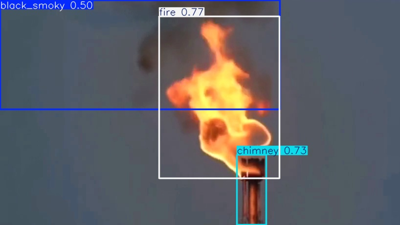
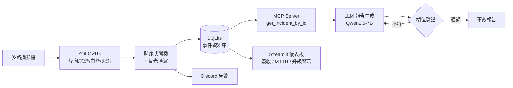
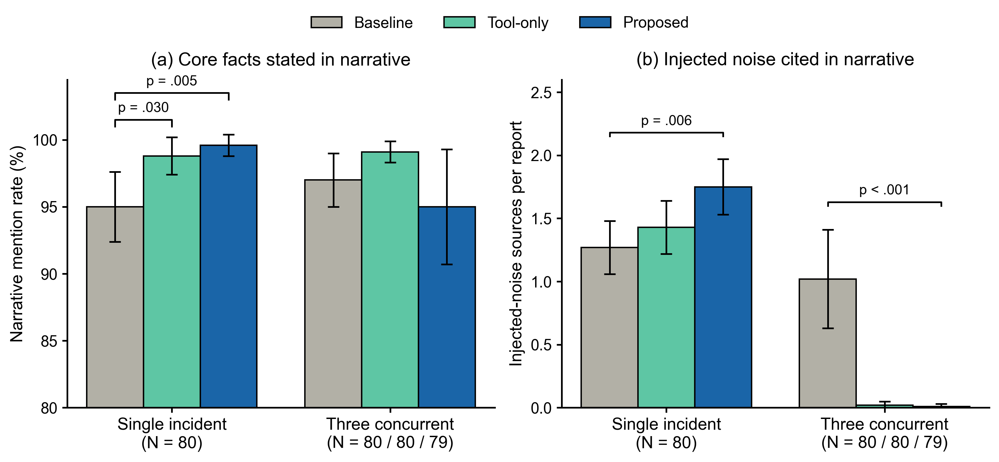

# Verified Fields, Unverified Narratives

> **Injected-Noise Uptake in Tool-Grounded LLM Incident Reports for Industrial Chimney Monitoring**
> Pin-Hao Wen、Shang-Liang Chen（指導教授）・國立成功大學 資訊工程學系
> 畢業專題的延伸研究

畢業專題（[chimney-monitor-capstone](https://github.com/JustinWen026/chimney-monitor-capstone)）做出了一套「YOLO 偵測 → 告警 → LLM 自動寫事故報告」的系統。這個研究問的是：**LLM 透過工具查到了正確資料，就一定會忠實寫進報告嗎？**

三組 LLM 都讀同一份**刻意植入已知假資訊**的原始日誌，比較以下三件事：

1. 讓 LLM 透過 MCP 工具查詢資料庫裡的事件資料（**Tool-only**），報告是否更忠實？
2. 再加上「輸出結構化 JSON → 與資料庫逐欄比對 → 不符就重試」的機制（**Proposed**），能否進一步改善？
3. 從一次處理一筆事件，擴大到三筆事件同時發生時，結論是否改變？



---

## 系統架構



相較於畢業專題，系統面新增了以下功能：
- 四類偵測：新增火焰類別，並支援「黑煙 + 火」複合事件。
- 多攝影機並行處理。
- SQLite 事件資料庫。
- Streamlit 閉環管理儀表板。
- 依 `incident_id` 精確查詢的 MCP 工具：修正多攝影機同時告警時，報告抓錯事件的競態條件。

## 實驗設計

| 組別 | 讀到的輸入 | 工具查詢 | JSON 欄位驗證 + 重試 |
|---|---|---|---|
| Baseline | 含雜訊的原始日誌 | ✗ | ✗ |
| Tool-only | 同上 | ✓（呼叫一次，不驗證） | ✗ |
| Proposed | 同上 | ✓ | ✓（最多重試 1 次） |

- **植入的雜訊**（系統中實際不存在的資訊）：
  - 假風速讀值
  - 假 SO₂ / NOx 空品數據
  - 假 email 通知
  - 無關時間戳
  - 影像處理參數
  - 無關的攝影機編號：單事故實驗用 `CAM-09`；並發實驗改用與真實編號極相似的 `CAM-01B` / `CAM-02B`
- **情境**：
  - 單一事故：事件 #54，黑煙 + 火。
  - 三事故並發：事件 #49、#54、#48，涵蓋火、黑煙 + 火、白煙三種類型。
- **設定**：`qwen2.5:7b-instruct`（Ollama 0.34.2）、temperature 0.8、明確設定 `num_ctx`、每組 N = 80、執行順序隨機。
- **評分**：
  - 核心事實提及率：報告敘事中是否正確寫出攝影機、事件類型、風險等級。
  - 雜訊引用數：報告引用了幾組植入的假資訊。
  - 統計方法：Welch t 檢定、Holm 校正、bootstrap 95% CI（5,000 次重抽樣）。

## 結果



| 情境 | 指標 | Baseline | Tool-only | Proposed |
|---|---|---|---|---|
| 單一事故（N = 80 / 80 / 80） | 核心事實提及率 | 95.0% | 98.8% | 99.6% |
| | 每份報告引用的雜訊組數 | 1.26 | 1.43 | 1.75 |
| 三事故並發（N = 80 / 80 / 79） | 核心事實提及率 | 96.9% | 99.0% | 94.9% |
| | 每份報告引用的雜訊組數 | 1.01 | **0.03** | **0.01** |

主要發現（p 值皆經 Holm 校正）：
- **被驗證的欄位從來沒錯**：
  - Proposed 產出的報告，JSON 欄位全部與資料庫一致（單事故 80/80，並發 76/76）。
  - 4 次重試全部是因為漏查事件，沒有一次是欄位抄錯。
  - 並發情境有 3 次（3.8%）最後沒有產出報告，另有 1 次執行中斷。
- **錯誤全部出在沒被驗證的敘事段落**：
  - 單事故情境下，有工具的兩組核心事實提及率都高於 Baseline（Baseline vs. Tool-only p = .030；Baseline vs. Proposed p = .005）。
  - 但 Proposed 引用的植入雜訊反而比 Baseline 多（1.75 vs. 1.26 組，p = .006），主要是假風速讀值，有些報告甚至把它當成事件原因。
  - 事後套用一條簡單規則「標記資料庫中不存在的數值」，就能抓出 83.8% 的 Proposed 單事故報告。
- **三事故並發**：
  - 有工具的兩組幾乎完全不再引用雜訊（p < .001）。
  - 核心事實提及率三組之間沒有顯著差異。
- **結論**：欄位驗證在兩種規模下，都沒有比單純的工具查詢帶來可量測的額外好處。驗證範圍應該延伸到敘事段落。

逐次原始輸出、計分結果與統計檢定都放在 [`reports/`](reports) 與 [`results/rescore_v3.json`](results/rescore_v3.json)。`figure5.py` 會從逐次分數重新計算全部數字，與論文表格不一致時會拒絕出圖。

## 研究方法上的把關

整個實驗過程中，我逐一排除可能讓結果失真的因素：

- **控制變因**：
  - 舊版並發實驗中，Tool-only 和 Proposed 實際上沒有接到雜訊日誌。v3 修正後，三組收到的日誌完全相同。
  - 單事故實驗加入 Tool-only 組，把「工具本身」和「驗證 + 重試」的貢獻拆開。
- **計分規則先寫死再重新計分**：`rescore.py` 修正了舊規則的誤判，例如把 `CAM-01B` 算成 `CAM-01`、把年份 2026 算成風險等級。修正後的規則在看新結果前就寫死，新舊規則的分數同時輸出。
- **檢查 prompt 有沒有被截斷**：`check_context.py` 比較預設 context 與大 context 下的 prompt token 數，確認 Ollama 沒有在沒有警告的情況下截斷輸入（結果見 [`results/context_check_result.json`](results/context_check_result.json)）。
- **評估工具的校準**：BERTScore 原本用的中文模型沒有官方 baseline，`rescale_with_baseline` 實際上沒有生效。後來改用 BERTScore 原論文的標準中文模型 `bert-base-chinese`。
- **LLM 裁判先驗證**：`hallucination_judge.py` 用另一家族的模型（Llama 3.1 8B）判斷報告是否把雜訊當成事件原因。正式使用前，先用 15 筆人工標註樣本（`run_judge_test.py`）檢驗它判得準不準。
- **雜訊依來源分組計分**：同一句話裡的多個假數值只算一次，避免數字被灌水。

## 版本歷程

| 時間 | 內容 |
|---|---|
| 2026/08 中 | 合併兩份資料集（4 類），訓練 YOLOv11s（best epoch 80，mAP50 0.785 / mAP50-95 0.468） |
| 2026/08 中 | 論文版偵測器：火焰類別、SQLite、Streamlit 儀表板、MCP + LLM 報告、BERTScore |
| 2026/08 下 | 多攝影機並行、反光過濾、誤判風險分析 |
| 2026/09 上 | 迭代閉環報告生成、MCP 依 ID 查詢、報告佇列；單事故消融實驗 v10 → v17 |
| 2026/09 中 | 並發消融實驗 v1 → v2、LLM 裁判；單事故正式實驗 N = 80 |
| 2026/09 下 | 並發實驗 v3（N = 80）、截斷檢查、重新計分、論文圖表 |

> **關於 commit 歷史：** 開發期間我用 `xxx_v2.py`、`xxx_v3.py` 這種檔名保存版本，沒有使用 git。上傳時，我把這些版本檔依實際修改時間依序重建成 commit，作者時間就是檔案當時的修改時間。各版本的修改理由都寫在程式碼開頭的註解裡，可以用 `git log -p ablation_single.py` 逐版查看實驗設計怎麼演進。

## 安裝與執行

環境：Python 3.10、NVIDIA GPU（RTX 5060），以及安裝好的 [Ollama](https://ollama.com)。

```bash
git clone https://github.com/JustinWen026/chimney-monitor-llm-faithfulness.git
cd chimney-monitor-llm-faithfulness
pip install -r requirements.txt
ollama pull qwen2.5:7b-instruct
```

| 目的 | 指令 |
|---|---|
| 即時偵測 + 自動報告（雙攝影機 Demo） | `python mvp_detector_visual_edge.py` |
| 管理儀表板 | `streamlit run dashboard.py` |
| 單事故消融實驗（論文用設定） | `python ablation_single.py 54` |
| 三事故並發消融實驗 | `python ablation_concurrent.py 49,54,48` |
| 重新計分 + 統計檢定 | `python rescore.py --multi reports/ablation_results_multi_v3_20260924_001727.json` |
| 誤判風險 / 關聯分析 | `python risk_analysis.py` |
| 重新訓練偵測模型 | 把資料集放到 `datasets/merged/` 後執行 `python train_yolo11.py` |

Discord 告警是選用功能，需設定環境變數 `DISCORD_WEBHOOK_URL`。

## 專案結構

```
├── mvp_detector_visual_edge.py   # 多攝影機偵測 + 狀態機 + 寫入資料庫 + 觸發報告
├── report_generator.py           # MCP 工具查詢 → 報告 → 欄位驗證 → 重試，BERTScore 評分
├── mcp_server.py                 # MCP Server（get_incident_by_id）
├── db_manager.py                 # SQLite 事件資料庫
├── dashboard.py                  # Streamlit 閉環管理儀表板
├── discord_notifier.py           # Discord 告警
├── ablation_single.py            # 單事故三組消融實驗 → reports/ablation_results_v12.json
├── ablation_concurrent.py        # 三事故並發消融實驗 → reports/ablation_results_multi_v3_*.json
├── rescore.py                    # 預先寫死的修正後規則重新計分 + 統計檢定
├── check_context.py              # 檢查 prompt 是否被靜默截斷
├── hallucination_judge.py        # LLM 裁判：雜訊是否被當成事件原因
├── run_judge_test.py             # 用人工標註樣本驗證裁判
├── figure5.py                    # 論文圖（數字與表格不符時拒絕出圖）
├── risk_analysis.py              # 誤判風險與結果歸因關聯分析
├── safety_incidents.db           # 事件資料庫快照（59 筆，實驗 ground truth 來源）
├── weights/best.pt               # YOLOv11s 四類別權重
├── datasets/                     # 資料集設定（影像需另外下載）
├── reports/                      # 實驗原始輸出、自動生成的事故報告
├── results/                      # 訓練結果、重新計分結果、截斷檢查
└── figures/                      # 論文圖
```

`ablation_single.py` 的輸出檔名 `ablation_results_v12.json` 沿用了早期版本的命名，內容是論文使用的 N = 80 正式實驗結果。

## 研究限制

- 只測試單一模型（Qwen2.5-7B），結論不一定適用於其他模型。
- 雜訊是我自行設計、植入的受控情境，不是真實事故資料。
- 測試影片由 PixVerse 以訓練資料集中的照片生成，不是實際廠區監視器畫面。
- 關鍵字式計分無法區分「誤信雜訊」和「提到雜訊但明確排除」兩種行為，所以另外開發 LLM 裁判，並以人工標註驗證。

## 開發工具

程式開發、分析繪圖程式與文件撰寫過程中，使用 Claude（Anthropic）作為輔助工具。

## 資料集與授權

- [chimney-l1vf2-wvsig](https://universe.roboflow.com/justins-workspace-3mnwz/chimney-l1vf2-wvsig)（煙囪 / 黑煙 / 白煙），CC BY 4.0
- [chimney-fire-smoke](https://universe.roboflow.com/justins-workspace-3mnwz/chimney-fire-smoke)（煙囪 / 黑煙 / 火焰），CC BY 4.0
- [fire-smoke](https://universe.roboflow.com/justins-workspace-3mnwz/fire-smoke-az0ku-erpy7)（重新標註火焰資料的來源）
